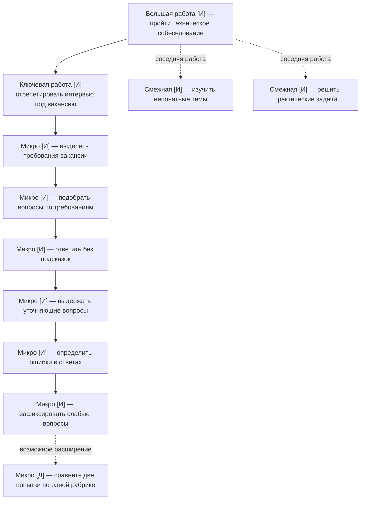

# ДЗ-4. Граф работ и карта сегментов

> Это же — материал промежуточной защиты.
> Пометка происхождения узлов — не формальность: на защите важно отличить содержание расшифровок от моих собственных предположений.

## Граф работ по итогам интервью

Для первого MVP я рассматриваю **B2C-работу «отрепетировать техническое собеседование по конкретной вакансии»**. Она описана в работе 1 из ДЗ-2 и в основном B2C-интервью из ДЗ-3. Граф строю именно вокруг этой задачи. B2B-скрининг не включаю в граф студента: это другая работа другого пользователя, которую сравниваю в карте сегментов.

**Происхождение:** **[И]** — действие или проблема прямо описаны в расшифровке; **[Д]** — мой вывод о структуре работ, предполагаемый шаг продукта либо непроверенная гипотеза. Во всех шести интервью ДЗ-3 собеседниками были **модельные персонажи**, поэтому [И] означает *«есть в тексте симуляции»*, а не *«подтверждено реальным пользователем»*.

Все ссылки ниже относятся к общей расшифровке **`dz_3_all_interviews_in_one.md`**. Для краткости: **B2C-осн.**, **B2C-1**, **B2C-2**, **B2B-осн.**, **B2B-1**, **B2B-2** — соответствующие разделы этого файла.

| Уровень | Работа | Происхождение |
|---|---|---|
| Большая работа — ради чего | **Пройти технический этап отбора** на интересующую вакансию. Это результат более высокого уровня, на который влияет не только тренировка. | **[И] B2C-осн.** Респондент говорил, что не хотел «слить шанс», а после настоящего интервью его пригласили дальше. **[Д]** Определение этого результата как *большой работы* — моя интерпретация. |
| Ключевая работа — что продукт выполняет целиком | **Отрепетировать техническое собеседование по конкретной вакансии**, отвечая самостоятельно и получая уточнения и разбор. | **[И] B2C-осн.** Знакомый около 40 минут задавал вопросы; отвечать вслух было труднее, чем читать готовые ответы. **[И] B2C-2.** Часовое пробное интервью с человеком стоило 1 500 ₽. |
| Смежная работа — того же уровня, продуктом не выполняется | **Изучить техническую тему**, которую пользователь ещё не понимает. Бот может указать на пробел, но не заменяет систематический курс. | **[И] B2C-осн.** Повторял SQL, HTTP, Docker; **[И] B2C-1.** Пользовался учебными статьями и YouTube. **[Д]** Решение не включать полноценное обучение в MVP — моё. |
| Смежная работа — того же уровня, продуктом не выполняется | **Решить практические задачи с кодом**, чтобы подготовиться к соответствующей части технического отбора. | **[И] B2C-осн.** Решал SQL-задачи; **[И] B2C-1.** Решал задачи на Codewars. **[Д]** В первом MVP не делаю отдельную среду для запуска и проверки кода. |
| Микроработа 1 | **Выделить требования вакансии**, по которым будут спрашивать. | **[И] B2C-осн.** После приглашения выписал Python, SQL, HTTP, Git и Docker. |
| Микроработа 2 | **Подобрать вопросы** по выбранным требованиям. | **[И] B2C-осн.** Искал подборки на GitHub и просил ChatGPT сгенерировать вопросы по вакансии. |
| Микроработа 3 | **Сформулировать ответ без подсказок**. | **[И] B2C-осн.** Читая вопрос, считал его знакомым; вслух сформулировать ответ было сложнее. |
| Микроработа 4 | **Ответить на уточняющие вопросы** по своему первому ответу. | **[И] B2C-осн.** Знакомый спрашивал «почему?» и «что будет, если…». **[И] B2C-2.** Уточнения задавал и человек на платном mock-интервью. |
| Микроработа 5 | **Определить ошибки** в собственных ответах. | **[И] B2C-2.** Интервьюер указал на конкретный недочёт в ответе про `LEFT JOIN`, а не просто оценил ответ как хороший или плохой. |
| Микроработа 6 | **Зафиксировать слабые вопросы** для дальнейшей подготовки. | **[И] B2C-осн.** После репетиции респондент выписал пять вопросов, на которые ответил плохо. Самостоятельное *повторение материала* относится уже к смежной работе «изучить тему». |
| Возможная микроработа 7 | **Сравнить ответы при повторной попытке** по одинаковым критериям. | **[Д]** В расшифровках нет последовательной оценки двух попыток; это предложенная мной функция проверки прогресса, взятая из гипотез ДЗ-2, а не услышанная работа. |

**Граница продукта.** В MVP входит сама репетиция — вопросы под вакансию, ответы без подсказок, уточнения и разбор слабых мест. **За рамками:** обучение программированию с нуля, полноценные кодинг-платформы, выбор вакансии и обещание оффера. Узел «сравнить попытки» — не обязательная часть MVP, пока не проверена надёжность оценивания.

## Критическая цепочка

Ниже я развернул описанный в **B2C-осн.** случай в хронологию: от приглашения до реального собеседования. **[И]** означает событие в смоделированном разговоре, **[Д]** — предполагаемый шаг будущего продукта. Повторная попытка, если понадобится, стоит **до настоящего интервью**, а не после него.

| Шаг | Что делает | Чем пользуется | Обрыв / переключение? |
|---|---|---|---|
| 1 | Получает приглашение на техническое собеседование: до него примерно 4–5 дней. | Сообщение HR, описание вакансии. | **Триггер [И].** Времени на подготовку мало. |
| 2 | Выписывает основные требования вакансии. | Вакансия, заметки. | **[И]** Появляется ограниченный список тем: Python, SQL, HTTP, Git, Docker. |
| 3 | Ищет вопросы и объяснения, открывает разные подборки. | GitHub, статьи, YouTube. | **Обрыв №1 [И]:** слишком много вопросов, неясно, что повторять за оставшееся время. **Переключение:** возвращается к требованиям самой вакансии и сокращает список тем. |
| 4 | Просит AI составить вопросы по вакансии и объяснить темы. | ChatGPT. | **Обрыв №2 [И]:** при самостоятельном использовании чата вместо интервью получается чтение ответов; респонденту не хватало строгой проверки. **Переключение:** договаривается с работающим разработчиком о mock-интервью. Это опыт персонажа, а не утверждение о любом AI-чате. |
| 5 | Отвечает вслух; получает уточняющие вопросы «почему?» и «что будет, если…». | Знакомый разработчик; около 40 минут. | **Обрыв №3 [И]:** видит, что узнавание правильного ответа и самостоятельное объяснение — разные вещи. **Переключение:** от простого чтения материалов к репетиции в разговоре. |
| 6 | Выписывает вопросы, на которых ошибся. | Результаты разговора, собственные заметки. | **[И]** Получает пять конкретных слабых вопросов, вместо бесконечного списка всех тем. |
| 7 | Повторяет материал по выявленным пробелам; при необходимости **[Д]** проходит ещё одну репетицию. | Учебные материалы; при повторном использовании — бот. | **[И]** Реальный персонаж повторял темы по заметкам. **[Д]** Повторная попытка через бота и сравнение баллов ещё не наблюдались. |
| 8 | Приходит на настоящее техническое собеседование. | Интервью с работодателем. | **[И]** В смоделированной истории получил приглашение на следующий этап. **Не доказано**, что результат вызван именно тренировкой. |

**Где появляется ценность продукта.** Главный переход — **шаги 3–6**: вместо самостоятельного перебора вопросов, неструктурированного чата и просьбы к знакомому пользователь проходит один последовательный mock-интервью. При этом бот не должен автоматически переходить к подробным объяснениям до ответа пользователя. Самая рискованная часть будущего решения — точность обратной связи и уточняющих вопросов: её ещё нужно проверить на примерах, оценённых человеком.

## Карта сегментов

Сегменты определяю **по работе и ситуации её возникновения**, а не по курсу обучения или размеру компании. Один человек может переходить из сегмента 2 в сегмент 1, когда его цель меняется с диагностики пробелов на репетицию разговора. Здесь сравниваю **три альтернативные аудитории/сценария для выбора направления MVP**. Сегмент 3 относится к **отдельному B2B-варианту продукта**, а не является подсегментом B2C: у рекрутера иная работа, иной критерий успеха и другой плательщик.

| Параметр | Сегмент 1 — отрепетировать назначенное интервью | Сегмент 2 — определить пробелы по вакансии | Сегмент 3 — обработать большой поток первичных интервью |
|---|---|---|---|
| Описание: работы и критерии успеха | **Работа:** отрепетировать интервью под вакансию, когда до него осталось несколько дней. **Успех:** отвечает без подсказок, справляется с уточнениями, получает конкретный список ошибок. **[И] B2C-осн., B2C-2.** Цель «10–12 вопросов за 30–40 минут» — **[Д]**, из ДЗ-2, не измерена. | **Работа:** определить темы, которые мешают подготовке к выбранной вакансии. **Успех:** понимает, что повторять в первую очередь, не тратит всё время на второстепенные темы. **[И] B2C-1.** Список из трёх тем и диагностика до 30 минут — **[Д]**, а не слова респондента. | **Работа:** провести первичный скрининг при большом потоке кандидатов без чрезмерных затрат времени рекрутера. **Успех:** меньше однотипных разговоров, понятные результаты для техлида, приемлемая доля завершений. **[И] B2B-осн., B2B-2.** Цель 5–7 минут на кандидата — **[Д]**, из ДЗ-2. |
| Размер — сколько таких людей | **[Д] ~75–400 потенциальных людей с нужным триггером в месяц** в гипотетических десяти студенческих чатах, к которым ещё нужно получить доступ. Это не клиенты и не весь рынок. | **[Д] ~150–800 потенциальных людей в месяц** в тех же чатах. Пересечение с сегментом 1 возможно; числа не складываются. | **[Д] ~3–18 рекрутеров/команд, потенциально подходящих по объёму**, если сделать 30–60 адресных обращений к компаниям в месяц. Это не численность рынка и не число покупателей. |
| Частота работы | По факту приглашения. **[Д]** Возможны 1–3 репетиции перед одним техинтервью; в симуляции описан один эпизод, частота не доказана. | По факту выбора вакансии и пересмотра плана подготовки. **[Д]** Предполагаю 1–2 диагностики на вакансию; данных о реальной частоте нет. | При волнах найма. **[И] B2B-осн.:** 18 кандидатов после отбора резюме; **[И] B2B-2:** 60 приглашений на тест. **[Д]** Важен объём за короткий период, частота таких волн неизвестна. |
| Бюджет работы — сколько уже тратят | **[И] B2C-осн.:** 0 ₽ на последнюю подготовку; **[И] B2C-2:** 1 500 ₽ за час mock-интервью с человеком. Это разные смоделированные случаи, не средний чек рынка. | **[И] B2C-1:** 0 ₽; за три дня потратил примерно 10–12 часов личного времени на подготовку. | **[И] B2B-осн.:** около 6 часов труда на одну волну первичных звонков; Google Forms без отдельной оплаты, стоимость ATS неизвестна. **[И] B2B-2:** используется корпоративная лицензия, её цена неизвестна. |
| Достижимость — можем ли дотянуться | **Относительно высокая [Д]:** сообщества по стажировкам, карьерные IT-чаты, студенческие каналы. Доступ, охваты и разрешение на публикации ещё не получены. | **Относительно высокая [Д]:** те же каналы, но триггер менее срочный; предложение легче отложить. | **Низкая/средняя [Д]:** нужно установить контакт с рекрутером и покупателем (HR Lead), согласовать тест, работу с данными кандидатов и доступ к воронке. |
| Возможность создать ценность | **Перспективная гипотеза:** один управляемый диалог вместо списков вопросов, неструктурированного AI-чата и поиска знакомого. **Риск:** неточная оценка модели обесценит обратную связь. | **Средняя гипотеза:** за ограниченное время указать приоритетные темы. **Риск:** бесплатные средства уже частично выполняют работу. | **Высокая при действительно большом потоке, низкая при малом.** **[И] B2B-1:** 8 звонков за две недели не были проблемой. **[И] B2B-2:** массовый тест заметно сокращал количество разговоров, но оставался риск ошибочного отсева. |
| Конкуренция | GitHub-подборки, YouTube, ChatGPT, знакомые разработчики, платные mock-интервью. **[И] B2C-осн., B2C-2.** | Тесты, Codewars, образовательные статьи, ChatGPT. **[И] B2C-1.** | ATS, Google Forms, звонки рекрутеров, платформы тестирования. **[И] B2B-осн., B2B-2.** |

**Откуда взялись оценки размера.** Это **расчётные допущения [Д]**, а не измеренный рынок:

- **B2C, потенциальный охват:** предполагаю 10 профильных чатов по 300–800 участников. Из-за пересечения аудиторий считаю уникальными условно 50%: `10 × (300–800) × 0,5 = 1 500–4 000` человек.
- **Сегмент 1:** гипотеза, что 5–10% этого пула в течение месяца имеют назначенное интервью: `1 500 × 5% = 75`; `4 000 × 10% = 400`.
- **Сегмент 2:** гипотеза, что 10–20% в месяц занимаются подготовкой под вакансии: `1 500 × 10% = 150`; `4 000 × 20% = 800`.
- **Сегмент 3:** гипотеза, что из 30–60 целевых HR-контактов в месяц 10–30% относятся к командам с регулярной волной найма: `30 × 10% = 3`; `60 × 30% = 18`. Одна команда — не обязательно один платящий клиент.

**Ограничение оценки:** размеры чатов, пересечения, наличие триггера, доля подходящих HR-команд, доступ к площадкам и конверсии **не проверены**. Эти числа задают порядок величины для эксперимента по каналам, а не доказывают SAM/TAM и не являются прогнозом продаж.

## Обоснование выбора целевого сегмента

**Выбор для первого MVP — сегмент 1: люди, у которых уже назначено техническое собеседование и которые хотят отрепетировать ответы под требования вакансии.** Это приоритет для проверки, не окончательное подтверждение спроса.

1. **Как мы создаём для них ценность? Какую работу выполняем лучше того, чем они пользуются сейчас:** в B2C-осн. пользовательский персонаж за четыре-пять дней до собеседования потратил около 6–7 часов, переходил между GitHub, YouTube, ChatGPT и разговором со знакомым. Наиболее полезной оказалась репетиция с уточняющими вопросами. В первом MVP я предлагаю один ограниченный сценарий: вставить требования вакансии → пройти 10–12 вопросов без готовых ответов → получить разбор конкретных ошибок и список 3–5 слабых тем. Ориентир — 30–40 минут на полную тренировку (**[Д]**, гипотеза). Продукт должен выигрывать у самостоятельной подготовки по **цельности процесса и качеству разбора**, но это ещё не подтверждено: нужен слепой тест оценок бота и человека на одних и тех же ответах.

2. **Как мы на них зарабатываем? За что и сколько платят, сходится ли с затратами:** сохраняю гипотезу из ДЗ-2: бесплатная короткая проба, **199 ₽ за полное интервью или 499 ₽ за три** (то есть ~166 ₽ за интервью в пакете). В симуляциях один студент не платил ничего, а другой заплатил 1 500 ₽ человеку; цена за AI пока не подтверждена. Для проверки экономики составил **не фактический расчёт, а тестовый сценарий [Д]**: при цене 199 ₽, переменных затратах на LLM 30 ₽, платёжной комиссии 3% (~6 ₽) и прочих переменных затратах 5 ₽ остаётся примерно **158 ₽ на покрытие привлечения и постоянных расходов**. Для пакета из трёх при тех же расходах — около **126 ₽ на одно интервью**. Если реальные расходы, платёжная комиссия или цена привлечения окажутся выше, модель может не сойтись. Перед запуском нужно измерить стоимость обработки 30–40-минутного диалога, ошибки/повторные генерации, конверсию в оплату и CAC. **Положительная прибыльность пока не доказана.**

3. **Как создаём спрос и растём внутри сегмента? Через кого дотягиваемся, хватит ли их:** сначала проверю гипотезу канала в студенческих IT-чатах и карьерных сообществах, где публикуются стажировки. Сообщение привязываю к триггеру: «Пригласили на техническое интервью? Пройдите короткую репетицию по своей вакансии». Проверяемая воронка: люди, увидевшие предложение → перешедшие в бота → начавшие бесплатную пробу → завершившие пробу → купившие полное интервью → вернувшиеся на вторую попытку. Числа потенциальной аудитории в таблице не равны охвату и спросу; первым делом надо проверить доступ к каналам и фактическую конверсию. Для роста можно тестировать рекомендации выпускников тренировок и пакеты перед следующим интервью.

**От чего отказались и почему:**

- **Сегмент 2 — пока не отдельный платный MVP.** Выявление пробелов важно, но в синтетическом B2C-1 персонаж уже использовал бесплатные материалы и AI. Оставляю краткую диагностику как результат репетиции, а не основной платный сценарий.
- **B2B — не первый MVP.** В B2B-1 небольшой поток не создавал выраженной проблемы; B2B-осн. и B2B-2 показывают, что при волне найма задача становится серьёзнее. Но в B2B более сложная продажа, нужен доступ к компаниям, работа с персональными данными и осторожность с AI-оценкой кандидатов. Тариф **4 900 ₽/мес.** из ДЗ-2 не подтверждён. B2B — отдельная гипотеза для следующих интервью и пилота.
- **Полное обучение программированию и кодинг-платформа — вне MVP.** Эти работы смежные; добавляя их, я потеряю фокус на репетиции.

**Что можно утверждать по ДЗ-3.** Все шесть интервью — симуляции, не живые респонденты. Они дают **трассировку сценариев и контрастные гипотезы**, но не реальные доли, рыночные размеры и проверенный платёжный спрос. На защите я отдельно обозначу, что взял из текста симуляций, а что достроил. Ближайшие проверки: 5–8 живых проблемных интервью с приглашёнными на технический этап студентами; сравнение качества разбора бота и человека; фактическая стоимость одного диалога; тест бесплатного входа и оплаты. Для B2B — реальные интервью с рекрутерами о числе первичных звонков, потерях времени и отказах кандидатов.

---

### Как будет оцениваться

| | |
|---|---|
| **A** | Граф построен на материале интервью: узлы прослеживаются до расшифровок. Различены уровни работ. В цепочке отмечены обрывы и переключения. Сегменты выделены по работам и критериям успеха, выбор обоснован через возможность создать ценность и заработать |
| **B** | Граф и цепочка построены корректно, но связь с интервью прослеживается частично; обоснование выбора опирается в основном на размер сегмента |
| **C** | Граф отражает функции продукта, а не работы пользователя; сегменты выделены преимущественно по демографии, отрасли или размеру компании |
| **D** | Граф работ отсутствует либо сегментация подменена описанием целевой аудитории |

Смена замысла по итогам интервью оценку не снижает. Отсутствие следов исследования — снижает.
