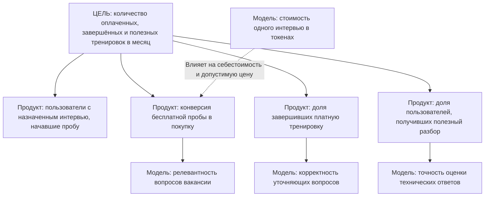

# ДЗ-6. Экономика, метрики, допущения

> Около 2 часов. Экономика без стоимости эксплуатации модели не принимается.
> Приблизительные цифры допустимы. Отсутствие целой статьи затрат — нет.

Для расчёта беру B2C-вариант продукта, который выбрал в ДЗ-4 и ДЗ-5: Telegram-бот для репетиции технического собеседования по конкретной вакансии.

Основной сценарий: пользователь отправляет описание вакансии, проходит тренировку с уточняющими вопросами и получает разбор ошибок.

Монетизация из ДЗ-2:
- Короткая бесплатная проба.
- Полное интервью — 199 ₽.
- Пакет из трёх интервью — 499 ₽.

Основной рынок — Россия и русскоязычная аудитория СНГ. Поэтому расчёты веду в рублях, а для инфраструктуры рассматриваю провайдеров с рублёвой тарификацией.

**Ограничение:** продукт пока не запущен, реальные продажи и расходы не измерялись. Ниже — сценарная экономика пилота. Тарифы провайдеров взяты из открытых источников, а количество пользователей, конверсия и объём запросов являются моими допущениями.

## Расчёт экономики

### Исходные допущения

Для модели беру один месяц работы небольшого MVP.

| Параметр | Значение | Основание |
|---|---:|---|
| Пользователи, начавшие бесплатную пробу | 300 | Гипотеза для пилота |
| Конверсия из бесплатной пробы в покупку | 10% | Гипотеза, необходимо проверить |
| Платящие пользователи | 30 | 300 × 10% |
| Покупают одно интервью | 70% | Гипотеза о структуре продаж |
| Покупают пакет из трёх | 30% | Гипотеза о структуре продаж |
| Продажи одного интервью | 21 | 30 × 70% |
| Продажи пакета из трёх | 9 | 30 × 30% |
| Количество оплаченных интервью | 48 | 21 + 9 × 3 |
| Стоимость привлечения платящего пользователя (CAC) | 120 ₽ | Предварительная гипотеза |
| Модель | Qwen3.6 35B | Через Yandex AI Studio |
| Хостинг | Timeweb Cloud | VPS с оплатой в рублях |

Для MVP предполагаю текстовое общение в Telegram. Голосовые сообщения, распознавание речи и синтез голоса пока не включаю, чтобы не усложнять разработку и экономику.

### Затраты на модель — четыре статьи

| Статья | Что входит | Оценка, ₽/мес | Откуда цифра |
|---|---|---:|---|
| Данные | Сбор и хранение вакансий, истории интервью, ответов и результатов, очистка старых данных и резервное копирование. | 300 | Условно 100 ₽ на дополнительное хранение и 200 ₽ в денежном эквиваленте на подготовку и обслуживание данных. |
| Разметка | Ручная проверка технических вопросов и оценок модели, исправление критериев оценивания, контроль качества обратной связи. | 1 200 | 2 часа проверки в месяц × условные 600 ₽/час. Даже если делаю сам, учитываю стоимость своего времени. |
| Обучение | Вычисления для обучения или дообучения собственной модели. | 0 | На первом этапе использую готовую модель через API, fine-tuning не провожу. Настройку промптов и сценариев учитываю как разработку, а не обучение модели. |
| Эксплуатация | Генерация вопросов, уточняющих вопросов, анализ ответов, итоговый отчёт, включая бесплатные пробы. | 1 620 | 300 бесплатных проб × 3 ₽ + 48 полных интервью × 15 ₽. |

**Итого затраты на модель и работу с данными: 3 120 ₽/мес.**

### Расчёт стоимости эксплуатации модели

Для предварительного расчёта выбрал **Qwen3.6 35B через Yandex AI Studio**.

По опубликованным тарифам в синхронном режиме:

- 1000 входных токенов — 0,20 ₽.
- 1000 выходных токенов — 0,30 ₽.

Цены указаны в рублях с НДС.

Источник: [Yandex AI Studio — правила тарификации](https://aistudio.yandex.ru/ru/docs/ai-studio/pricing).

**Одно полное интервью**

Предполагаю, что за одно текстовое интервью с учётом повторной передачи контекста потребуется:

- 50 000 входных токенов.
- 8 000 выходных токенов.

Расчёт:

```text
Входные токены:
50 000 / 1000 × 0,20 = 10 ₽

Выходные токены:
8 000 / 1000 × 0,30 = 2,40 ₽

Итого:
10 + 2,40 = 12,40 ₽

С резервом на повторные генерации:
15 ₽ за интервью.
```

**Бесплатная короткая проба**

Для бесплатной пробы предполагаю расход 12 000 входных и 2 000 выходных токенов.

```text
Входные токены:
12 000 / 1000 × 0,20 = 2,40 ₽

Выходные токены:
2 000 / 1000 × 0,30 = 0,60 ₽

Итого:
2,40 + 0,60 = 3 ₽.
```

**Стоимость эксплуатации за месяц**

```text
300 бесплатных проб × 3 ₽ = 900 ₽

48 полных интервью × 15 ₽ = 720 ₽

Общие затраты на API:
900 + 720 = 1 620 ₽/мес.
```

При таком сценарии бесплатные пробы обходятся даже дороже, чем эксплуатация платных интервью, поскольку бесплатных пользователей значительно больше.

Поэтому конверсия в оплату и ограничения бесплатной версии напрямую влияют на экономику продукта.

**Важно:** количество токенов пока предполагаемое. После появления MVP я планирую измерять его по фактическим запросам API. Качество модели на технических вопросах по Python, SQL и другим темам также ещё предстоит проверить.

### Остальные затраты

| Статья | Оценка, ₽/мес | Обоснование |
|---|---:|---|
| Хостинг Telegram-бота | 900 | VPS Timeweb Cloud, базовый тариф в Москве |
| Поддержка и исправление ошибок | 400 | Условная оценка собственного времени |
| Привлечение пользователей | 3 600 | 30 платящих пользователей × CAC 120 ₽ |
| Затраты на данные | 300 | Из таблицы затрат на модель |
| Разметка и проверка качества | 1 200 | Из таблицы затрат на модель |
| Обучение | 0 | Дообучение не используется |
| Эксплуатация модели | 1 620 | Бесплатные и платные интервью |
| **Итого** | **8 020** | **Все ежемесячные затраты пилота** |

Источник стоимости VPS: [Timeweb Cloud — VPS/VDS](https://timeweb.cloud/services/vds-vps).

В расчёте использую вариант сервера за 900 ₽/мес. Для небольшого текстового бота этого предварительно достаточно, поскольку сама языковая модель запускается через внешний API.

Первоначальную разработку MVP не включаю в ежемесячные расходы. Это отдельные стартовые вложения, которые необходимо учитывать при оценке полной окупаемости проекта.

### Выручка за месяц

Предполагаю, что 70% покупателей оплачивают одно интервью, а 30% выбирают пакет из трёх.

```text
21 покупатель × 199 ₽ = 4 179 ₽

9 покупателей × 499 ₽ = 4 491 ₽

Общая стоимость проданных услуг:
4 179 + 4 491 = 8 670 ₽.
```

Для продажи цифровых услуг внутри Telegram предусмотрена оплата через **Telegram Stars**.

Источник: [Telegram — Bot Payments for Digital Goods](https://core.telegram.org/bots/payments-stars).

На данном этапе я не знаю точный рублёвый эквивалент поступлений после конвертации и вывода Stars для своего сценария.

Поэтому закладываю **условный резерв 25%** от стоимости покупок на возможные потери при расчётах и выводе средств.

Это не официальная комиссия Telegram, а моё финансовое допущение.

```text
8 670 × 0,75 = 6 502,50 ₽.
```

Таким образом, в сценарной модели остаётся **6 502,50 ₽ поступлений**.

### Финансовый результат месяца

```text
Поступления:          6 502,50 ₽
Ежемесячные затраты:  8 020,00 ₽
--------------------------------
Финансовый результат: -1 517,50 ₽
```

При 30 платящих пользователях в месяц проект пока не покрывает все предполагаемые расходы.

Основная причина — небольшое количество покупателей относительно затрат на привлечение, поддержку и бесплатные пробы.

В расчёт пока не включены налоги, первоначальная разработка, возможные возвраты сверх заложенного резерва и юридическое сопровождение. Поэтому это предварительный операционный результат, а не полноценный бухгалтерский расчёт чистой прибыли.

### Экономика в расчёте на пользователя

Здесь под пользователем понимаю **нового платящего клиента**.

| Показатель | Значение | Как посчитано |
|---|---:|---|
| Стоимость привлечения одного пользователя | 120 ₽ | 3 600 ₽ рекламных расходов / 30 покупателей |
| Доход с пользователя в месяц | 216,75 ₽ | Средняя покупка 289 ₽ × 75% после условного резерва на Stars |
| Затраты на пользователя в месяц | 267,33 ₽ | Общие расходы 8 020 ₽ / 30 покупателей |
| Доход за время жизни (LTV) | 260,10 ₽ | Гипотеза 1,2 покупки за весь срок использования × 216,75 ₽ |
| Срок окупаемости CAC | Первая покупка | Маржинального дохода с первой покупки достаточно для покрытия предполагаемого CAC, но не всех постоянных расходов |

**Подробный расчёт среднего дохода:**

```text
Средняя покупка:

0,7 × 199 + 0,3 × 499 = 289 ₽

После резерва 25%:

289 × 0,75 = 216,75 ₽.
```

**Расходы на одного платящего пользователя:**

На одного покупателя в среднем приходится 1,6 полного интервью и 10 бесплатных проб во всей воронке.

```text
Полные интервью:
1,6 × 15 = 24 ₽

Бесплатные пробы:
10 × 3 = 30 ₽

Привлечение:
120 ₽

Постоянные расходы на покупателя:
(300 + 1 200 + 900 + 400) / 30
= 93,33 ₽

Итого:
24 + 30 + 120 + 93,33
= 267,33 ₽.
```

**LTV:**

Предполагаю, что за всё время использования пользователь совершит в среднем 1,2 покупки. Это пока неподтверждённая гипотеза.

```text
LTV = 216,75 × 1,2 = 260,10 ₽.
```

Это пожизненные поступления после условного резерва на Stars, а не чистая прибыль с пользователя.

**Окупаемость привлечения:**

С одной первой покупки после расходов на эксплуатацию платных интервью и бесплатные пробы остаётся:

```text
216,75 − 24 − 30 = 162,75 ₽.
```

Эта сумма больше предполагаемого CAC 120 ₽.

Следовательно, при выполнении допущений **привлечение окупается уже первой покупкой**.

Но после вычета CAC остаётся только:

```text
162,75 − 120 = 42,75 ₽.
```

Эти деньги ещё должны покрыть постоянные расходы. Поэтому окупаемость привлечения не означает, что весь продукт уже прибылен.

### Точка безубыточности

Постоянные расходы в месяц:

```text
Данные:      300 ₽
Разметка:  1 200 ₽
Хостинг:     900 ₽
Поддержка:   400 ₽
-----------------
Итого:     2 800 ₽.
```

Маржинальный доход с одного нового покупателя после CAC и переменных расходов:

```text
216,75 − 24 − 30 − 120 = 42,75 ₽.
```

Тогда для покрытия постоянных расходов необходимо:

```text
2 800 / 42,75 ≈ 65,5.
```

**Предполагаемая точка безубыточности — 66 новых платящих пользователей в месяц.**

Это справедливо при сохранении среднего чека, конверсии, CAC и других допущений.

Полная окупаемость разработки потребует дополнительных продаж.

### Проверка на десятикратный рост

Проверяю два сценария: рост только нагрузки на модель и рост нагрузки вместе с продажами.

**Сценарий 1. Число обращений к модели выросло в 10 раз, но доход не изменился.**

Такое возможно, если пользователи начинают гораздо чаще использовать бесплатную пробу или бот делает слишком много запросов.

| Показатель | Базовый месяц | Нагрузка ×10 |
|---|---:|---:|
| Платящие пользователи | 30 | 30 |
| Поступления после резерва Stars | 6 502,50 ₽ | 6 502,50 ₽ |
| Эксплуатация модели | 1 620 ₽ | 16 200 ₽ |
| Все остальные затраты | 6 400 ₽ | 6 400 ₽ |
| Общие затраты | 8 020 ₽ | 22 600 ₽ |
| **Финансовый результат** | **−1 517,50 ₽** | **−16 097,50 ₽** |

В этом сценарии для простоты прочие расходы оставлены неизменными. Если потребуется увеличить серверные мощности и поддержку, убыток окажется ещё больше.

**Вывод:** увеличение нагрузки на модель само по себе не создаёт ценности для бизнеса. Если обращения растут без роста оплат, экономика быстро ухудшается.

Поэтому для бесплатной версии необходимы ограничения на количество вопросов, длину ответов и число тренировок.

**Сценарий 2. Аудитория и продажи выросли в 10 раз.**

Предполагаю:

- 3 000 бесплатных проб.
- 300 платящих пользователей.
- 480 оплаченных интервью.

| Показатель | Базовый месяц | Рост аудитории ×10 |
|---|---:|---:|
| Бесплатные пробы | 300 | 3 000 |
| Платящие пользователи | 30 | 300 |
| Поступления после резерва Stars | 6 502,50 ₽ | 65 025 ₽ |
| Эксплуатация модели | 1 620 ₽ | 16 200 ₽ |
| Привлечение | 3 600 ₽ | 36 000 ₽ |
| Данные | 300 ₽ | 700 ₽ |
| Разметка | 1 200 ₽ | 4 800 ₽ |
| Обучение | 0 ₽ | 0 ₽ |
| Хостинг | 900 ₽ | 1 500 ₽ |
| Поддержка | 400 ₽ | 2 000 ₽ |
| **Общие затраты** | **8 020 ₽** | **61 200 ₽** |
| **Финансовый результат** | **−1 517,50 ₽** | **+3 825 ₽** |

При пропорциональном росте продаж экономика потенциально улучшается, поскольку часть расходов растёт медленнее количества пользователей.

Однако это возможно только при сохранении конверсии и стоимости привлечения.

На практике CAC может увеличиться, а качество модели и нагрузка на поддержку — ухудшиться. Поэтому этот сценарий нельзя считать прогнозом прибыли.

**Главный вывод проверки:** необходимо контролировать не только число обращений к модели, но и стоимость одного завершённого платного интервью, конверсию в оплату и долю бесплатных пользователей.

## Дерево метрик

Главная цель продукта — **увеличивать количество пользователей, которые оплатили, завершили и получили полезную тренировку перед техническим собеседованием**.

Это именно поведение людей, а не метрика качества модели.



### Метрики продукта

| Метрика | Что показывает | Как измерить |
|---|---|---|
| Количество пользователей с назначенным интервью | Достигаем ли нужного сегмента | Уточнение цели при запуске бота |
| Конверсия бесплатной пробы в оплату | Готовы ли платить за предлагаемую ценность | Покупатели / пользователи, начавшие пробу |
| Доля завершённых платных интервью | Удаётся ли выполнить ключевую работу | Завершённые интервью / начатые платные интервью |
| Полезность обратной связи | Понимает ли пользователь, что ему нужно улучшить | Оценка полезности и перечисление конкретных ошибок после тренировки |
| Повторные покупки | Есть ли ценность в повторном использовании | Количество пользователей, оплативших следующую тренировку |
| CAC | Сколько стоит привлечение покупателя | Расходы на привлечение / новые покупатели |

### Метрики модели

| Метрика | Что показывает | Начальный ориентир |
|---|---|---|
| Релевантность вопросов | Соответствуют ли вопросы требованиям вакансии | Не менее 80% по независимой проверке |
| Корректность уточнений | Логично ли модель продолжает интервью | Не менее 90% корректных уточнений |
| Точность оценки ответов | Насколько оценка модели согласуется с экспертной | Не менее 80% совпадений по выбранной рубрике |
| Стоимость полного интервью | Сколько обходится обработка одного диалога | Ориентир до 15 ₽ |

Целевые показатели пока не подтверждены тестами.

**Причинная связь:** если модель задаёт нерелевантные вопросы, пользователи могут не увидеть пользу бесплатной пробы и не перейти к покупке. Если уточнения некорректные, пользователи могут бросать платные интервью. Если ошибки определяются неправильно, результат не будет считаться полезным.

Таким образом, качество модели влияет на продуктовые метрики, но не заменяет их.

Даже технически качественная модель не обеспечивает успешный продукт, если пользователи не проходят тренировки или не готовы платить.

## Рискованные допущения

Допущения ранжирую по двум признакам:

1. **Последствия:** насколько сильно ошибка повлияет на продукт.
2. **Неопределённость:** насколько мало сейчас подтверждений.

| № | Допущение | Что будет, если неверно | Уверенность (высокая / средняя / низкая) |
|---|---|---|---|
| **1** | Люди с назначенным техническим собеседованием готовы платить около 199 ₽ за специализированную AI-репетицию вместо бесплатного ChatGPT. | Платный B2C-продукт может оказаться невостребованным. Последствия критические, неопределённость высокая. | **Низкая:** реальных продаж и интервью с пользователями пока нет. |
| **2** | Qwen3.6 35B сможет давать достаточно точные технические вопросы, уточнения и оценки ответов. | Бот будет создавать неверную обратную связь и терять доверие пользователей. Последствия критические, неопределённость высокая. | **Низкая:** качество ещё не проверялось на экспертной выборке. |
| **3** | Через студенческие IT-сообщества удастся привлекать платящих пользователей с CAC около 120 ₽. | Реальные расходы на привлечение могут превысить допустимую маржу. Последствия высокие, неопределённость высокая. | **Низкая:** рекламных тестов ещё не было. |
| **4** | После конвертации и вывода Telegram Stars проект сохранит не менее 75% условной стоимости покупки. | Фактические поступления будут ниже, а точка безубыточности увеличится. Последствия высокие. | **Низкая:** точная экономика расчётов через Stars ещё не проверена. |
| **5** | Полное текстовое интервью будет обходиться примерно в 15 ₽ через API. | При большем расходе токенов себестоимость вырастет и маржа уменьшится. Последствия умеренные, неопределённость средняя. | **Средняя:** тариф известен, но фактическое потребление токенов неизвестно. |
| **6** | Удастся организовать безопасную обработку вакансий и ответов пользователей без чрезмерных дополнительных расходов. | Придётся увеличивать стоимость инфраструктуры, ограничивать хранение данных или менять архитектуру. Последствия высокие. | **Низкая:** требования к обработке данных и расходы на их соблюдение ещё не проработаны полностью. |

Главным допущением считаю **готовность платить**.

Если пользователи не готовы оплачивать репетицию, то даже качественная модель и низкая стоимость API не обеспечат жизнеспособную бизнес-модель.

Поэтому сначала стоит проверить спрос, а не тратить время на полноценную разработку.

## План проверки главного допущения

| | |
|---|---|
| **Допущение** | Люди, у которых уже назначено техническое собеседование, готовы платить около 199 ₽ за специализированную тренировку. |
| **Способ проверки** | Без разработки полноценного бота найду 15–20 человек с назначенным техническим интервью. Проведу для них короткую бесплатную репетицию вручную с помощью LLM. Затем предложу конкретное платное продолжение за 199 ₽ и зафиксирую, сколько человек попросят перейти к покупке. Не буду ограничиваться вопросом «Вы бы пользовались?». |
| **Срок** | 7 дней: 1–2 дня на поиск участников, 3–4 дня на проведение коротких репетиций, 1 день на анализ результатов. |
| **Признак подтверждения** | Из 20 целевых участников хотя бы 10 завершают бесплатную пробу, а минимум 3 оставляют конкретную заявку на платное продолжение. Это предварительный сигнал спроса, который затем необходимо подтвердить реальными платежами. |
| **Признак опровержения** | Большинство участников отказывается даже от короткой бесплатной тренировки либо никто не выбирает платное продолжение из-за бесплатных альтернатив или недостаточной пользы. |

Заявку на покупку не считаю фактической оплатой. Если первый тест покажет интерес, следующим этапом проверка реальных платежей через Telegram Stars, фактическую себестоимость и качество обратной связи.

Дополнительно можно провести небольшой технический тест модели: взять 20–30 вопросов по Python и SQL с экспертными ответами и сравнить оценивание Qwen с человеческой рубрикой.

Это позволит заранее обнаружить грубые ошибки, не создавая полноценный продукт.

---

### Как будет оцениваться

| | |
|---|---|
| **A** | В расчёте учтены стоимости данных, разметки, обучения и эксплуатации; показано, что происходит при росте нагрузки. Дерево метрик причинно связано с целью, метрики продукта и модели различены. Допущения ранжированы, для верхнего назван самый дешёвый способ проверки |
| **B** | Расчёт полон, но чувствительность к нагрузке не показана; ранжирование допущений сделано без явного основания |
| **C** | Экономика посчитана без затрат на модель; дерево метрик — список показателей без связи с целью |
| **D** | Расчёта нет либо допущения не выделены |
